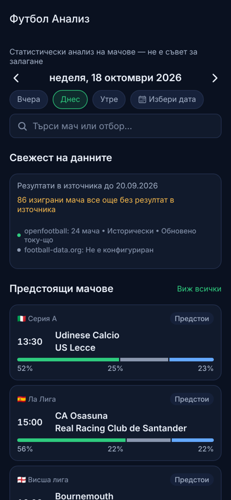
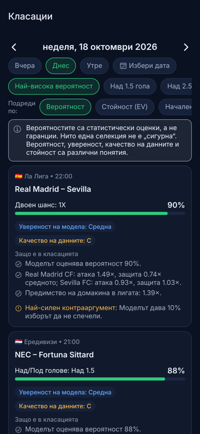
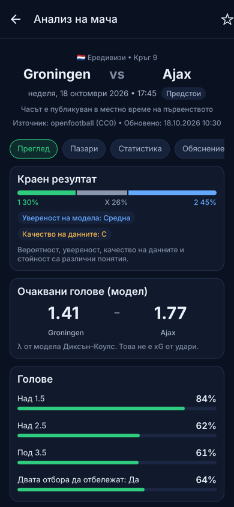
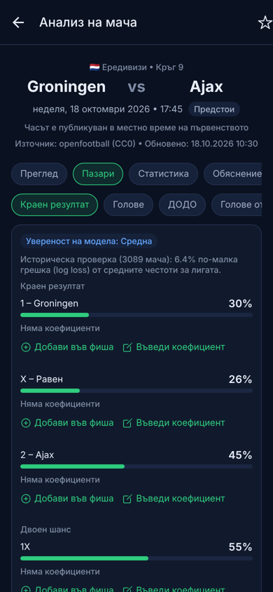

# Футбол Анализ — football analytics for iPhone

An iPhone app (Expo / React Native, TypeScript) for researching football matches before kickoff:
fixtures by date, team statistics, a statistical goal model, probabilities for the major betting
markets, odds/expected-value comparison when legitimate odds exist, daily rankings, a hypothetical
bet slip, and tracking of the model's own accuracy. The interface is in Bulgarian (English included).

> **This is an analysis tool, not a bookmaker.** It takes no bets, connects to no gambling account,
> and never calls a selection “safe” or “guaranteed”. Probabilities are statistical estimates.

| Area | Status |
| --- | --- |
| App compiles to an iOS bundle (Metro → Hermes bytecode, 1,567 modules) | ✅ verified (`expo export --platform ios`) |
| Unit, integration and screen tests | ✅ 232 / 232 passing (15 suites) + 10 / 10 proxy tests |
| Type-check and lint | ✅ clean |
| Real fixtures for a date from a free source (openfootball) | ✅ verified live: 24 fixtures on 18 Oct 2026, predictions for all of them |
| Model validated out of sample (walk-forward, 3,089 matches) | ✅ see [Model and validation](#model-and-validation) |
| Running on a physical iPhone or the iOS Simulator | ⚠️ **not verified** — this environment has no macOS/Xcode or device |
| football-data.org and The Odds API integrations | ⚠️ **not verified live** — both hosts are blocked by this build environment's network policy; implemented against their v4 schemas and tested with mocked responses |

Preview renders (react-native-web in headless Chromium at iPhone width — **not** captured on an iPhone):

| Home | Rankings | Match | Markets |
| --- | --- | --- | --- |
|  |  |  |  |

---

## Contents

1. [Install and run on an iPhone](#install-and-run-on-an-iphone)
2. [Optional free API keys (football-data.org, The Odds API)](#optional-free-api-keys)
3. [Data providers and their terms](#data-providers-and-their-terms)
4. [Markets: implemented and unavailable](#markets-implemented-and-unavailable)
5. [Model and validation](#model-and-validation)
6. [Features by screen](#features-by-screen)
7. [Architecture](#architecture)
8. [Tests and results](#tests-and-results)
9. [Building an installable iOS app](#building-an-installable-ios-app)
10. [Known limitations and unresolved issues](#known-limitations-and-unresolved-issues)
11. [Roadmap (no paid services needed)](#roadmap-no-paid-services-needed)

---

## Install and run on an iPhone

Requirements: **Node.js 20.19+ or 22** and npm on your computer; on the iPhone, **Expo Go** from the App Store.

```bash
git clone https://github.com/7czkvfwvgz-commits/Project.git
cd Project
git checkout claude/iphone-football-analytics-8ql0f0
cd mobile
npm install
npx expo start
```

Scan the QR code with the iPhone Camera app; it opens the project in Expo Go. The phone and computer
must be on the same Wi-Fi network — otherwise use `npx expo start --tunnel`.

No account or key is needed: fixtures, results and the model work immediately from openfootball.

**Expo SDK version.** The project uses **Expo SDK 57** (React Native 0.86) on purpose. SDK 58 was released
on 15 Oct 2026, but Expo's own changelog says the App Store build of Expo Go for SDK 58 arrives “within a
few weeks”, and the App Store Expo Go runs one SDK at a time. When the store version moves to SDK 58,
upgrade with:

```bash
cd mobile && npx expo install expo@^58.0.0 --fix
```

**iOS Simulator (macOS with Xcode):** `cd mobile && npx expo start --ios` installs Expo Go in the simulator and opens the app.

Useful scripts (`mobile/`):

| Command | What it does |
| --- | --- |
| `npm start` | Expo dev server |
| `npm test` | Jest (unit, integration and screen tests) |
| `npm run typecheck` / `npm run lint` | TypeScript and ESLint |
| `npm run verify` | all three |
| `npm run smoke [-- YYYY-MM-DD]` | live end-to-end run against openfootball (providers → model → ranking), no mocks |
| `npm run backtest` | re-run the walk-forward validation and regenerate `src/data/backtest.json` |

---

## Optional free API keys

The app never contains provider keys. Keys live only in a tiny proxy (`server/`), which adds them to
upstream requests, whitelists endpoints, validates parameters, rate-limits, and caches.

**1. Get the free keys**

| Provider | Register | Free tier |
| --- | --- | --- |
| football-data.org | https://www.football-data.org/client/register — the key arrives by e-mail | 12 competitions, 10 requests/minute, scores may be delayed |
| The Odds API | https://the-odds-api.com → choose the free plan | small monthly request quota; current odds only |

Both are optional and independent.

**2. Run the proxy**

```bash
cd server
npm install
cp .env.example .env      # then put FOOTBALL_DATA_API_KEY / ODDS_API_KEY in .env
npm start                 # http://localhost:8787 — check http://localhost:8787/v1/health
```

**3. Point the app at it**

```bash
cd mobile
cp .env.example .env
# EXPO_PUBLIC_PROXY_URL=http://<your computer's LAN IP>:8787   (localhost does not work from a phone)
npx expo start -c
```

`EXPO_PUBLIC_*` values are compiled into the app and are **public** — that is why only the proxy URL goes
there. If you set `CLIENT_TOKEN` in `server/.env`, set the same value as `EXPO_PUBLIC_PROXY_CLIENT_TOKEN`;
it only deters casual reuse of your quota (it is not a secret).

**Free hosting (optional):** the proxy is a standard fetch handler and runs on Cloudflare Workers' free plan:

```bash
cd server
cp wrangler.toml.example wrangler.toml
npx wrangler secret put FOOTBALL_DATA_API_KEY
npx wrangler secret put ODDS_API_KEY
npx wrangler deploy
```

Settings → Data sources → “Check proxy server” shows whether the app can reach it and which keys it has.

---

## Data providers and their terms

| Provider | Role | Key | Terms / licence | Notes |
| --- | --- | --- | --- | --- |
| [openfootball / football.json](https://github.com/openfootball/football.json) | fixtures, results, half-time scores, computed tables, model history | none | **CC0-1.0** (public domain) | Regenerated daily from Football.TXT; **not live**. At the time of writing the current season's results stop at **20 Sep 2026** (~4 weeks behind) — the app shows this lag and lowers confidence and data quality accordingly. |
| [football-data.org](https://www.football-data.org) API v4 | fixtures with exact UTC kickoffs, live/finished status, scores, official standings | free key, via proxy | free tier after registration; attribution “Football data provided by the Football-Data.org API” | Merged with openfootball (same match → one fixture; status/kickoff/score from football-data). Free tier has no lineups, cards or statistics. |
| [The Odds API](https://the-odds-api.com) v4 | bookmaker odds: 1X2 (`h2h`) and goal totals | free key, via proxy | free plan with a monthly quota | Matched to fixtures only when both team names (on the correct sides) and kickoff agree; otherwise no odds are shown. Proxy caches 3 h to save quota. |
| Manual odds | odds the user types in | — | stored on the device | Labelled “entered manually” with entry time; enables EV and the slip without any key. |
| Demo | fictional league | — | — | Off by default; every screen shows a demo banner; never mixed with real fixtures. |

**Kickoff times.** openfootball publishes local times without a zone. Each league's convention was checked
against openfootball's explicit-offset files and standard kickoff slots: EPL matched 361/361 explicit
times, Bundesliga likewise; Austria's file turned out to use UK time. Leagues where the convention could
not be verified (League One/Two, Scottish Premiership, 2. Bundesliga, Serie B, Ligue 2, Belgium, Greece,
Turkey, Segunda) show **the date only** rather than risk a wrong time. All conversions use a deterministic
DST rule table checked hour by hour against ICU for 2024–2030; the default zone is **Europe/Sofia**,
changeable in Settings (36 zones).

**Competitions:** Premier League, Championship, Bundesliga, La Liga, Serie A, Ligue 1, Eredivisie,
Primeira Liga, Brasileirão and Austrian Bundesliga by default; League One/Two, 2. Bundesliga, Segunda,
Serie B, Ligue 2, Scottish Premiership, Belgium, Greece, Turkey can be enabled (openfootball publishes some
of these seasons late). Champions League, World Cup and Euro appear only through football-data.org and
have no model (no free history).

---

## Markets: implemented and unavailable

Every probability is computed by applying the market's **exact settlement rule** to one scoreline
distribution, so markets are mutually consistent by construction and expected value respects pushes and
half wins/losses.

| Group | Selections | Status |
| --- | --- | --- |
| Match result | 1X2, double chance (1X, X2, 12), draw no bet (push on draw) | ✅ |
| Total goals | Over/Under 0.5, 1.5, 2.5, 3.5, 4.5, 5.5 | ✅ |
| Both teams to score | Yes / No | ✅ |
| Team goals | home and away Over/Under 0.5, 1.5, 2.5 | ✅ |
| Correct score | 12 most likely scorelines + 0–5 heat grid | ✅ |
| Asian handicap | 9 quarter-step lines around the fair line, both sides, with win / half-win / push / half-loss / loss | ✅ |
| European handicap | ±1, ±2, three-way | ✅ |
| Half-time | HT 1X2, HT Over/Under 0.5/1.5/2.5, HT BTTS, HT/FT (9 combinations) | ✅ from observed per-league first-half goal shares; lower confidence (extra assumptions) |
| Corners (incl. Asian corners) | — | ❌ “Insufficient data”: no configured free source provides corner data |
| Cards | — | ❌ “Insufficient data”: no reliable free disciplinary feed configured |
| Player markets | — | ❌ “Insufficient data”: no free player-level data configured |

Corners, cards and player markets are deliberately **not** derived from the goal model. Odds are available
only for 1X2 and goal totals (The Odds API free plan) or whatever the user enters manually; every other
market is probability-only.

---

## Model and validation

**Model:** time-weighted Dixon–Coles (1997). Per league, team attack and defence plus home advantage are
maximum-likelihood estimates of a Poisson model, fitted by iterative proportional fitting on the previous
and current season with exponential time decay; each team is shrunk towards a prior (promoted teams start
from the average of the teams they replaced); the low-score correction ρ is then estimated by maximum
likelihood (two-stage). The expected match total is shrunk towards the league mean while keeping each
side's share, because team “style” proved far noisier than relative strength. Fitting uses only results
**strictly before** the match date (tested). Head-to-head results are displayed but have no influence.

**Fallbacks (documented):** a team with no data → league averages (confidence capped at 30); a league with
fewer than 40 results → typical rates of 1.54/1.27 goals (confidence capped at 15); fewer than 150 results →
no ρ (plain Poisson).

**Validation** (`scripts/backtest.ts`, results in `mobile/src/data/backtest.json`, shown in the app):
walk-forward on real openfootball data for 10 leagues; each match predicted from results before its date.
Parameters were chosen on **2023-24 and 2024-25** only (half-life 270 days, prior 4 matches, total shrink
θ = 0.55) and evaluated once on **2025-26** (3,089 matches). Baseline = previous season's league frequencies.

| Metric (2025-26, out of sample) | Model | Baseline |
| --- | --- | --- |
| Ranked probability score, 1X2 | **0.2068** | 0.2306 |
| Log loss, 1X2 | **1.0086** | 1.0772 |
| Brier, 1X2 | **0.6030** | 0.6519 |
| Log loss, half-time 1X2 | **1.0558** | 1.0892 |
| Log loss, Over 2.5 | 0.6850 | 0.6878 |
| Log loss, BTTS | 0.6873 | 0.6878 |
| Calibration error (ECE), 1X2 / Over 2.5 / BTTS | 0.009 / 0.035 / 0.027 | — |

Plain reading: the model is clearly better than the baseline and well calibrated for **match result**;
for **goal totals and BTTS it is only marginally better** (2025-26 also had more goals than either model
expected). The app says so: those markets carry an explicit “weak validated skill” confidence reduction.
Calibration has been checked only on this historical sample; nothing here demonstrates profitability.

**Confidence vs data quality vs probability vs value** are separate and shown separately:
*confidence* reflects sample size, newcomers, early season, fallbacks, out-of-date team data (capped at
“medium” when either team's last known result is more than three weeks old), market skill and scope;
*data quality* reflects missing results, source lag, missing kickoff time, half-time coverage, stale cache
and the absence of xG/lineups; *EV* exists only for a current, valid quote of the exact selection.

---

## Features by screen

- **Home** — selected date, data-freshness card (latest result in source, unplayed results missing,
  per-provider status), match search, upcoming fixtures with 1/X/2 bars, top of the daily shortlist,
  favourite competitions, responsible-use reminder.
- **Matches** — previous/next day, Yesterday/Today/Tomorrow, native date picker, ranges up to 7 days,
  competition/country/status filters, team search, kickoff in the chosen zone (DST-safe, midnight
  crossing handled), statuses scheduled/live/finished/postponed/cancelled/“no result in source”,
  pull-to-refresh, skeletons, and distinct states for *no matches*, *no supported competitions*,
  *API failure* (“does not mean there are no matches”), *rate limit*, *missing credentials* and
  *stale cached data*; source attribution and last-update time for every provider.
- **Match analysis** — Overview (1X2, model expected goals λ — explicitly not shot xG — key totals,
  score grid, odds or “Odds unavailable”, confidence and data-quality reasons, model version and data
  dates), Markets (all groups above; per selection: probability, settlement breakdown, market-level
  confidence, odds with source and timestamp, implied probability, EV or the reason it is disabled,
  add to slip, enter odds; per group: supporting statistics and the main reasons it could fail),
  Statistics (last 5/10 form, goals chart, season/home/away records, clean sheets, BTTS and O/U
  frequencies, halves, computed or official table, head-to-head, and advanced data listed as
  unavailable with the sources checked), Explanation (rule-based, labelled “no AI”).
  Favourite toggle; “Record prediction” stores an immutable snapshot before kickoff.
- **Analysis** — rankings: highest probability, Over 1.5, Over 2.5, Under 3.5, BTTS, 1X2, positive EV,
  best data quality, high uncertainty; filters for league, country, market, minimum probability, data
  quality, confidence and EV; sort by probability, EV, kickoff or confidence; each item explains why it
  is listed and gives the strongest counter-argument; “No selection meets the chosen criteria” when empty.
- **Saved** — favourites, prediction snapshots, saved slips (all offline from SQLite), result check,
  link to model performance and the current slip.
- **Hypothetical slip** — add/remove selections, stake, combined odds only for different matches with
  valid prices, gross return and net profit, combined probability (joint from the scoreline matrix for
  same-match full-time selections, otherwise “Unavailable due to correlation”), stale/started warnings,
  save, automatic settlement from results and manual outcome recording.
- **Performance** — your snapshots: totals, settled, hit rate, Brier, log loss, RPS, calibration table
  with Wilson intervals, by market, by competition, level-stake P&L when odds were recorded, sample-size
  warnings; plus the shipped backtest with calibration charts.
- **Settings** — time zone, language (Bulgarian/English), favourite and enabled competitions, fair-odds
  and compact display, provider diagnostics, cache size and clearing, responsible use (hide all betting
  features, reminders, betting notifications — the app sends none), auto-record, demo mode, attribution.

---

## Architecture

```
Project/
├── mobile/                      Expo SDK 57 app (iOS)
│   ├── app/                     Expo Router screens: (tabs)/index|matches|analysis|saved|settings,
│   │                            match/[id], slip (modal), slips/[id], performance, providers
│   ├── src/time/tz.ts           DST rule engine + calendar-day helpers (verified against ICU)
│   ├── src/config/              competition registry (openfootball / football-data / odds keys, zones), env
│   ├── src/domain/              Fixture/team types, name normalisation for cross-provider matching
│   ├── src/providers/           provider abstraction (fixtures, results, statistics, odds, standings)
│   │   ├── openfootball/        CC0 season files: per-record Zod validation, kickoff zones, statuses
│   │   ├── footballData/        v4 via proxy
│   │   ├── odds/                The Odds API via proxy; manual odds
│   │   ├── demo/                fictional league
│   │   ├── cache.ts, http.ts    ETag revalidation, stale fallback, de-duplication, timeouts, bounded backoff
│   │   └── aggregate.ts         merge providers, decide the list state
│   ├── src/engine/              poisson, scoreMatrix (Dixon–Coles), fit, halftime, settlement, markets,
│   │                            odds/EV, assessment (confidence, quality), predict, teamStats, ranking,
│   │                            explain, slip, metrics, performance, validation
│   ├── src/db/                  SQLite schema (immutable prediction trigger) and repositories
│   ├── src/services/, hooks/    analysis orchestration; TanStack Query hooks (no polling)
│   ├── src/state/               Zustand stores persisted in SQLite key-value storage
│   ├── src/i18n/                Bulgarian (primary) and English dictionaries
│   ├── src/ui/                  theme, components, match tabs
│   ├── scripts/                 backtest.ts, smoke.ts
│   └── __tests__/, test-utils/  Jest suites, Node-SQLite adapter, synthetic league, fake fetch
├── server/                      API-key proxy (Node or Cloudflare Workers) + tests
└── docs/screenshots/            preview renders
```

Libraries (versions pinned to SDK 57 by `expo install`): expo-router, expo-sqlite (data + key-value
storage), @tanstack/react-query, zod, zustand, react-native-gifted-charts (+ react-native-svg),
@react-native-community/datetimepicker and netinfo, @expo/vector-icons.

Caching and rate limits: season files are cached in SQLite (3 h for the current season, 7 days for past
ones, 12 h for “not published yet”) and revalidated with ETags; failed refreshes fall back to the cached
copy with a visible “cached data from …” banner; identical requests share one network call; retries are
limited to two, with exponential backoff, and never retry rate limits or client errors; there is no
polling — refresh is pull-to-refresh or a reconnect. The proxy keeps football-data.org under 8 calls/minute
and caches odds for 3 hours.

Security: no keys in the app or repository (`.env` files are git-ignored; `.env.example` files are
provided), keys only on the proxy, whitelisted read-only endpoints, keys never echoed in responses or
errors (tested), every external payload validated with Zod, provider failures turned into typed states.

---

## Tests and results

```bash
cd mobile && npm run verify     # tsc + eslint + jest
cd server && npm test && npx tsc --noEmit
```

Results from the final run of this delivery:

| Check | Result |
| --- | --- |
| `mobile` TypeScript (`tsc --noEmit`) | ✅ 0 errors |
| `mobile` ESLint (expo config incl. React Compiler rules) | ✅ 0 problems |
| `mobile` Jest | ✅ **232 passed / 232**, 15 suites |
| `server` TypeScript | ✅ 0 errors |
| `server` tests (node:test) | ✅ **10 passed / 10** |
| `expo export --platform ios` | ✅ bundles (4.4 MB Hermes bytecode) |
| `npm run smoke` (live openfootball, 18 Oct 2026) | ✅ 24 fixtures, 24 predictions, 0 consistency failures |

What the suites cover:

- **Unit:** Poisson; scoreline matrix and Dixon–Coles τ; 1X2, double chance, DNB, totals (complementary
  and monotone), BTTS (matrix and closed form), team totals vs Poisson tails; Asian/European handicap and
  quarter-line settlement table; implied probability, margin, fair probabilities, EV with pushes and half
  outcomes; stale/after-kickoff odds; time zones (36 zones vs ICU, DST gaps/overlaps, 23/25-hour days,
  matches crossing midnight); Brier, log loss, RPS, Wilson intervals, calibration, P&L; slip combined odds,
  correlation and accumulator settlement; model recovery on a synthetic league, no future-data leakage,
  promoted-team priors, fallbacks; ranking filters, EV ranking and explanations; localisation
  completeness and the “no safe/guaranteed” rule.
- **Integration (mocked HTTP):** openfootball local-day filtering, statuses, coverage, ETag/304, stale
  fallback, unverified-zone leagues, datasets; football-data.org mapping (timed/scheduled/live/extra time,
  skipped records), proxy configuration; odds event matching and quote mapping; aggregation states and
  provider merging; demo provider; SQLite repositories on real SQL incl. the immutability trigger,
  settlement, voiding, favourites, slips, manual odds and cache.
- **Screens (expo-router testing library, real route tree):** Matches (local times, search, API failure,
  no coverage, demo labelling), Match analysis (probabilities, “Odds unavailable”, market groups,
  unavailable corners, advanced data, rule-based explanation, prediction snapshot, not-found),
  time-zone effect on kickoff times, slip correlation handling, empty slip disclaimer.
- **Proxy:** missing credentials, parameter validation, caching, stale-on-error, upstream rate limit,
  whitelists, quota header, no key leakage, client token, method restrictions.

---

## Building an installable iOS app

Expo Go is enough for development. For an app installed without Expo Go, use EAS Build (`mobile/eas.json`
has three profiles). Change `ios.bundleIdentifier` in `mobile/app.json` (currently
`com.example.footballanalytics`) to an identifier you own first.

```bash
npm install -g eas-cli
cd mobile
eas login                                      # free Expo account
eas build -p ios --profile simulator           # .app for the iOS Simulator — no Apple account needed
eas device:create                              # register your iPhone (ad-hoc builds)
eas build -p ios --profile preview             # installable .ipa — needs an Apple Developer Program membership
eas build -p ios --profile production && eas submit -p ios   # TestFlight / App Store
```

Set `EXPO_PUBLIC_PROXY_URL` for builds as an EAS environment variable (it is public, not a secret).
Nothing in this section was run here: it needs an Expo login and, for devices, an Apple Developer
account that this environment does not have.

---

## Known limitations and unresolved issues

- **Not run on iOS.** No macOS/Xcode or iPhone was available. Verification consists of the iOS Metro
  bundle, the Jest React Native renderer tests and a web-rendered visual preview.
- **football-data.org and The Odds API were never called for real** — this environment's network policy
  blocks both hosts. Their mappings follow the documented v4 schemas and are tested with mocked payloads;
  please check them with your keys (Settings → Data sources).
- **openfootball lags** (currently ~4 weeks of missing results), which is why confidence is capped and
  data quality downgraded; adding football-data.org improves statuses and recent scores for its 12
  competitions but the model's history still comes from openfootball.
- **No free xG, shots, corners, cards, lineups or injuries** in the configured sources; those sections
  say so, and corner/card/player markets are unavailable.
- **Goal-total and BTTS markets have weak validated skill**; half-time/full-time assumes independent halves;
  promoted teams use a relegated-team prior rather than their lower-league record; cup competitions have
  no model.
- **The Odds API free quota is small**; the proxy caches 3 hours, so prices can be up to 3 h old (they
  are flagged stale after 6 h, and EV is disabled after kickoff).
- **Explanations are rule-based only.** No LLM provider is wired in; the explanation object is marked
  `generator: 'rules'`, ready for an optional server-side provider.
- **Notifications:** the app sends none; the betting-notification setting stays off by default.
- **`npm audit`** reports 66 advisories (16 moderate, 50 high, 0 critical) in Expo's own CLI/bundler
  dependency tree (node-forge, xcode, metro …). They are pinned by Expo SDK 57; `npm audit fix --force`
  would break SDK compatibility. The proxy has 0.
- **Expo Go timing:** when the App Store Expo Go switches to SDK 58, upgrade as described above.

## Roadmap (no paid services needed)

1. Use lower-league results (e.g. Championship → Premier League) to rate promoted teams.
2. Recalibrate goal totals per league (season-level scoring drift) and add a bivariate/negative-binomial
   variant; keep the walk-forward backtest as the acceptance gate.
3. Card markets from openfootball's “full” files (bookings) once they cover the current season.
4. Optional server-side LLM explanations that may only paraphrase the structured output (numbers checked
   against it) and are clearly labelled as AI-generated.
5. Kickoff-time verification for more leagues as explicit-offset data appears.
6. Local, opt-in kickoff reminders for favourite matches (never betting prompts).
7. Export/import of predictions and slips; iCloud backup.

## Responsible use

Betting carries a risk of loss; only stake what you can afford to lose. If gambling is causing problems,
seek professional help (e.g. https://www.begambleaware.org). For adults only. The app can hide all
betting features (odds, EV, slip) in Settings → Responsible use.
